# Bambu2OBS

**Live Bambu Lab printer telemetry as a native OBS Studio source. No Python, no Browser Source, no localhost server.**

[](CHANGELOG.md)
[](native/CMakeLists.txt)
[](native/CMakeLists.txt)
[](docs/ARCHITECTURE.md#decision-a-qt-settings-dialog)
[](https://obsproject.com/)
[](#requirements)
[](docs/LEGACY_PYTHON.md)
[](#license)
[](https://github.com/stef1949/Bambu2OBS/actions/workflows/native-package.yml)

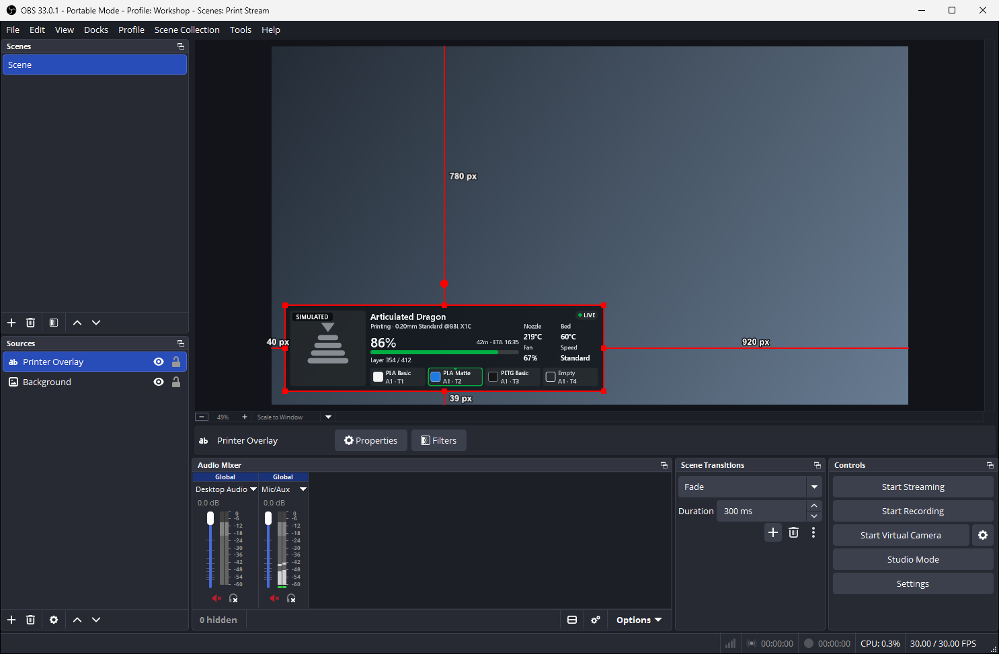

**Bambu Printer Overlay** draws your printer's progress, temperatures, and AMS trays as one transparent broadcast graphic. It runs entirely inside OBS as a single DLL, and live data comes straight from the printer over your local network. Bambu Cloud is optional.

> [!IMPORTANT]
> **Pre-release.** Version 0.3.0 has no tagged release yet and has not been tested against a physical printer. It has only run against a simulated printer, so please expect rough edges. See [Validation status](native/README.md#validation-status).

> This is a community plugin. It is not affiliated with or endorsed by OBS Project or Bambu Lab.

## Contents

- [Features](#features)
- [Installation](#installation)
- [Quick start](#quick-start)
- [Usage](#usage)
- [Configuration](#configuration)
- [Documentation](#documentation)
- [Development and testing](#development-and-testing)
- [Contributing](#contributing)
- [License](#license)

## Features

- **Live telemetry:** progress, time left, finish time, stage, layers, temperatures, fan, and speed
- **AMS trays:** material, colour, and the active slot, across multiple AMS units
- **Print previews:** from Bambu Cloud, or from the `.3mf` on the printer
- **Three presets:** Compact, Dashboard, and Expanded
- **Four themes:** dark, light, high contrast, and custom colours
- **Honest states:** `LIVE`, `STALE`, `RECONNECTING`, and `OFFLINE`, keeping the last known values on screen
- **Readable on stream:** text stays large enough for a 720p stream, and small sources show less rather than shrinking it
- **One connection per printer:** several overlays on the same printer share it
- **Credentials kept out of scene files:** access codes stay in Windows Credential Manager, and you approve each printer's certificate before anything is sent
- **Simulation mode:** sample data for every state, with no printer and no network use

**Presets**

| Compact | Expanded, two AMS units |
| --- | --- |
| 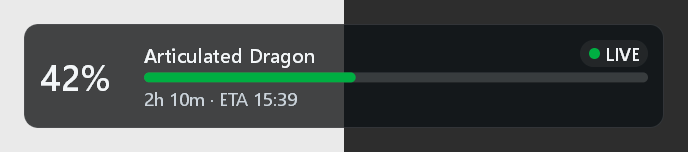 | 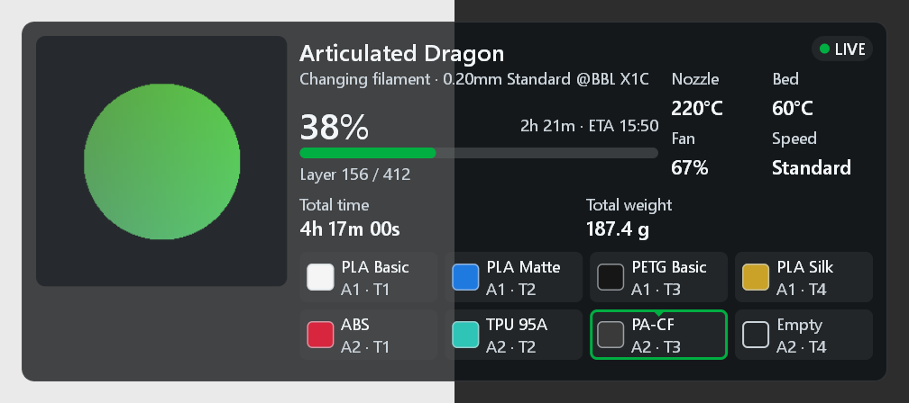 |

**Themes**

| Light | High contrast | Custom |
| --- | --- | --- |
| 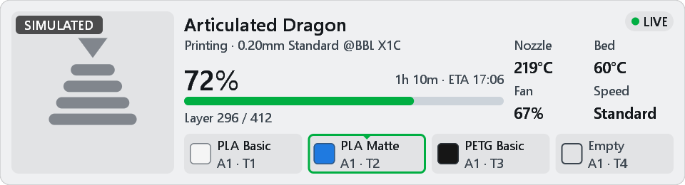 | 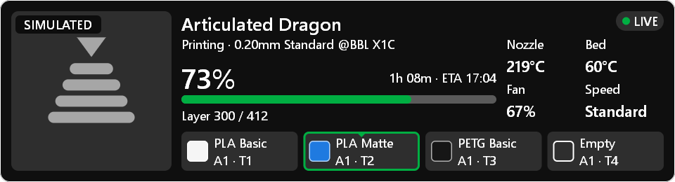 | 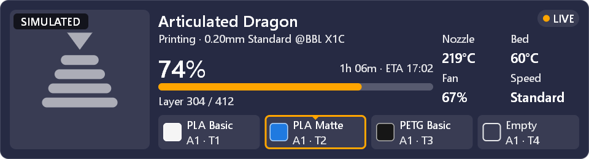 |

**States**

| Stale data | Printer offline |
| --- | --- |
| 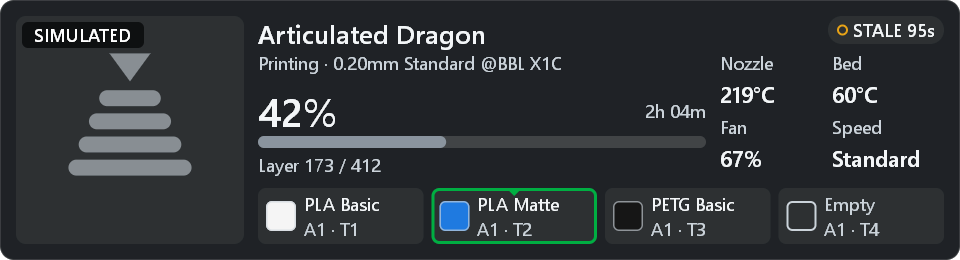 | 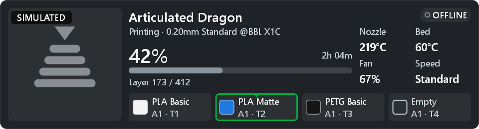 |

Stale and offline overlays grey out the progress bar and hide the finish time, because a clock time based on old data would be a guess. Shape shows state as well as colour: the status dot is filled when live and a ring when not.

### Known limitations

- Windows only.
- Not yet tested against a physical printer.
- Stage and material names are English only, as they come from a fixed table.
- Removing a stored cloud token currently means deleting and re-adding the profile.

## Installation

### Requirements

- Windows 10 or 11, 64-bit
- OBS Studio 33 or newer, which is the first version to use this plugin layout
- A Bambu Lab printer on the same network, with LAN access available

### Get the package

There is no tagged release yet. Once there is, the installer, ZIP, and checksums will be on the [Releases page](https://github.com/stef1949/Bambu2OBS/releases). Until then, [build the package](#build) yourself, or download `Bambu-Printer-Overlay-Windows-x64` from a successful [CI run](https://github.com/stef1949/Bambu2OBS/actions/workflows/native-package.yml). Packages aren't code-signed, so Windows may show a SmartScreen warning. Check them against the `.sha256` file beside them.

### Installer

1. Close OBS.
2. Run `Bambu-Printer-Overlay-<version>-Windows-x64-Setup.exe` and approve the administrator prompt.
3. Start OBS.

The plugin installs to `C:\ProgramData\obs-studio\plugins\bambu-printer-overlay`.

### ZIP

Extract the ZIP, close OBS, then run this from an elevated PowerShell window in that folder:

```powershell
powershell -NoProfile -ExecutionPolicy Bypass -File .\install.ps1
```

The script checks every file against the package manifest, refuses to run while OBS is open, and backs up any existing copy.

### Optional extras

None of these are needed for live telemetry.

| Extra | What it adds | How to get it |
| --- | --- | --- |
| **Bambu Cloud** | Cover images, design titles, and total time and weight for cloud prints | Add a cloud token in the [settings dialog](#printer-profiles) and untick **LAN only** |
| **Portable OBS** | Install into a portable copy of OBS | Add `-ObsPluginRoot 'D:\OBS\plugins'` to the ZIP install command, using the `plugins` folder in its install root |
| **Automation** | Control overlays from scripts and tools | Built into OBS. See [Usage](#usage) |
| **Legacy Python app** | The original Flask version, kept for reference | `python -m pip install -r requirements.txt`, then see [`docs/LEGACY_PYTHON.md`](docs/LEGACY_PYTHON.md) |

### Upgrade and uninstall

To upgrade, close OBS and install the newer version over the old one. Moving from the Python version? See the [migration guide](docs/MIGRATION.md).

To uninstall, close OBS and run this from an elevated PowerShell window:

```powershell
powershell -NoProfile -ExecutionPolicy Bypass -File 'C:\ProgramData\obs-studio\plugins\bambu-printer-overlay\data\uninstall.ps1'
```

## Quick start

### 1. See it working, with no printer

1. In a scene, choose **Sources > + > Bambu Printer Overlay**, then **OK**.
2. In the properties window, scroll to **Diagnostics**, tick **Simulation mode**, and set **Simulated state** to **Printing**.
3. Press **OK**, then drag the overlay to where you want it.

You'll see the overlay from the top of this page, marked `SIMULATED`. The background is transparent, so place it above your camera or printer feed.

### 2. Connect your printer

On the printer, find its **IP address** and **LAN access code** in the network settings, and its **serial number** in the device information. Treat the access code like a password.

1. In OBS open **Tools > Bambu Printer Overlay Settings** and press **Add**.
2. Fill in the details, then press **Save**.
3. Press **Test Connection**. OBS shows the printer's certificate fingerprint. Confirm the address is your printer and accept.

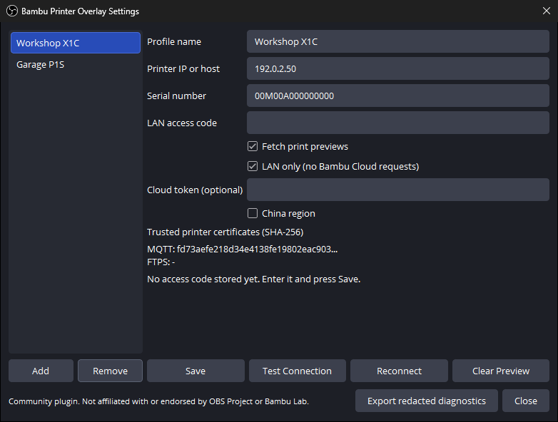

*The values shown are samples: `192.0.2.50` is an address reserved for documentation.*

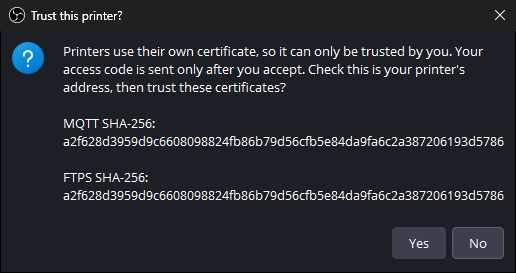

Printers use their own certificates, which only you can vouch for, so nothing is sent until you accept. Your access code then goes only to that certificate.

### 3. Go live

Open the source's properties, untick **Simulation mode**, and choose your printer under **Connection**. The badge on the overlay changes to `LIVE` once data arrives.

## Usage

Most people only need the properties window. To automate overlays, use the source through OBS's own interfaces.

### Source reference

The plugin has no C API of its own. Everything is reached through this OBS source:

| | |
| --- | --- |
| **Source ID** | `bambu_printer_overlay` |
| **Settings** | Every key in the [settings reference](#source-settings) |
| **Printer list** | The items of the `profile_id` list property |
| **Buttons** | `reconnect`, `open_settings`, `export_diagnostics` |

Three things to know:

- **Set the size with the preset.** Changing `layout_preset` from code does not resize the source, so send `source_width` and `source_height` too. Only the properties window applies the preset's size for you.
- **Colours are `0xAABBGGRR` integers,** not `0xRRGGBB`. See the helper below.
- **Secrets and telemetry are not exposed.** Scripts can't set an access code or read printer data. Add printers in the settings dialog.

### Python, through obs-websocket

obs-websocket ships with OBS. Turn it on under **Tools > WebSocket Server Settings**, then install a client:

```shell
pip install obsws-python
```

```python
import obsws_python as obs

client = obs.ReqClient(host="localhost", port=4455, password="your-password")
scene = client.get_current_program_scene().scene_name
overlay = "Printer Overlay"

# Add an overlay showing sample data.
client.create_input(
    scene,
    overlay,
    "bambu_printer_overlay",
    {"simulation_mode": True, "simulation_fixture": 1},
    True,
)

# List the printers from Tools > Bambu Printer Overlay Settings.
# The first item is the "(choose a printer)" placeholder.
printers = client.get_input_properties_list_property_items(overlay, "profile_id").property_items
for printer in printers[1:]:
    print(printer["itemName"], printer["itemValue"])

# Switch to the Compact preset, sending its size as well.
client.set_input_settings(
    overlay,
    {"layout_preset": "compact", "source_width": 640, "source_height": 104},
    True,
)


# Use a custom accent colour.
def obs_color(hex_rgb):
    red, green, blue = bytes.fromhex(hex_rgb.lstrip("#"))
    return 0xFF000000 | blue << 16 | green << 8 | red


client.set_input_settings(overlay, {"accent_color": obs_color("#FFA500")}, True)

# Connect to the first printer, then force a reconnect.
if len(printers) > 1:
    client.set_input_settings(
        overlay,
        {"profile_id": printers[1]["itemValue"], "simulation_mode": False},
        True,
    )
    client.press_input_properties_button(overlay, "reconnect")
```

### Lua, as an OBS script

Save this as `overlay-layout.lua` and add it under **Tools > Scripts**. It adds two layout buttons:

```lua
local obs = obslua
local SOURCE_NAME = "Printer Overlay"

local function apply_layout(preset, width, height)
    local source = obs.obs_get_source_by_name(SOURCE_NAME)
    if source == nil then
        return
    end

    local settings = obs.obs_data_create()
    obs.obs_data_set_string(settings, "layout_preset", preset)
    obs.obs_data_set_int(settings, "source_width", width)
    obs.obs_data_set_int(settings, "source_height", height)
    obs.obs_source_update(source, settings)

    obs.obs_data_release(settings)
    obs.obs_source_release(source)
end

function script_description()
    return "Switch the printer overlay between layouts."
end

function script_properties()
    local props = obs.obs_properties_create()
    obs.obs_properties_add_button(props, "compact", "Compact", function()
        apply_layout("compact", 640, 104)
    end)
    obs.obs_properties_add_button(props, "dashboard", "Dashboard", function()
        apply_layout("dashboard", 960, 260)
    end)
    return props
end
```

## Configuration

### Printer profiles

Add printers under **Tools > Bambu Printer Overlay Settings**, shown in the [quick start](#2-connect-your-printer).

| Field | Required | Notes |
| --- | --- | --- |
| **Profile name** | No | The name shown in the source's printer list. Defaults to the address |
| **Printer IP or host** | Yes | A DHCP reservation stops it changing |
| **Serial number** | Yes | From the printer's device information |
| **LAN access code** | Yes | Changes if LAN mode is toggled or the printer is reset |
| **Fetch print previews** | No | Reads the `.3mf` from the printer, or cover images from the cloud |
| **LAN only** | No | Blocks all Bambu Cloud requests |
| **Cloud token** | No | Enables cloud previews and details. Untick **LAN only** to use it |
| **China region** | No | Uses the China cloud service |

| Stored item | Location |
| --- | --- |
| Access codes and cloud tokens | Windows Credential Manager, under `bambu-printer-overlay/<profile-id>/` |
| Profiles and approved certificate fingerprints | `%APPDATA%\obs-studio\plugin_config\bambu-printer-overlay\profiles.json` |
| Preview cache | The `cache` folder beside `profiles.json` |

Removing a profile deletes its stored secrets. Scene collections only hold the `profile_id`.

### Source settings

Each source has its own settings, in its properties window. The tables give the keys for [automation](#usage).

#### Connection and layout

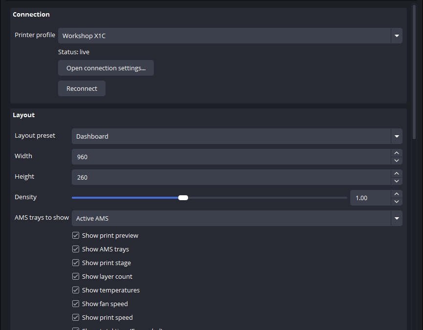

| Key | Type | Default | Values |
| --- | --- | --- | --- |
| `profile_id` | string | empty | A printer's ID. See [Source reference](#source-reference) |
| `layout_preset` | string | `dashboard` | `compact` (640x104), `dashboard` (960x260), `expanded` (960x400) |
| `source_width` | int | `960` | 320 to 3840 |
| `source_height` | int | `260` | 72 to 2160 |
| `density` | float | `1.0` | 0.6 to 1.6 |
| `ams_mode` | int | `1` | `0` first AMS, `1` active AMS, `2` all AMS units |
| `show_preview`, `show_ams`, `show_stage`, `show_layers` | bool | `true` | Show or hide the section |
| `show_temperatures`, `show_fan`, `show_speed`, `show_badge` | bool | `true` | Show or hide the section |
| `show_total_time`, `show_total_weight` | bool | `true` | Show or hide the section, in Expanded only |

#### Appearance

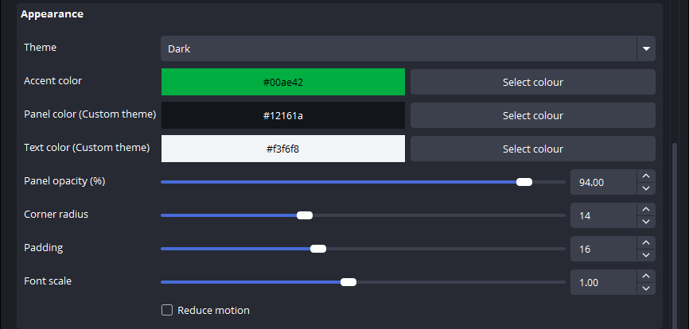

| Key | Type | Default | Values |
| --- | --- | --- | --- |
| `theme` | int | `0` | `0` dark, `1` light, `2` high contrast, `3` custom |
| `accent_color` | int | `0xFF42AE00` | `0xAABBGGRR`. The default is `#00AE42` |
| `background_color` | int | `0xFF1A1612` | `0xAABBGGRR`, used by the custom theme |
| `text_color` | int | `0xFFF8F6F3` | `0xAABBGGRR`, used by the custom theme |
| `panel_opacity` | float | `94.0` | 30 to 100 percent |
| `corner_radius` | int | `14` | 0 to 40 |
| `padding` | int | `16` | 6 to 32 |
| `font_scale` | float | `1.0` | 0.7 to 1.4 |
| `reduce_motion` | bool | `false` | Jump to new progress values instead of animating |

#### Formatting and diagnostics

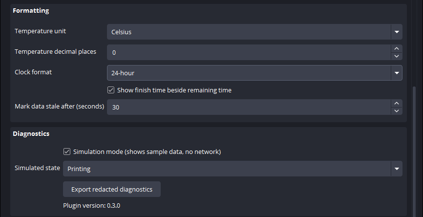

| Key | Type | Default | Values |
| --- | --- | --- | --- |
| `temperature_unit` | int | `0` | `0` Celsius, `1` Fahrenheit |
| `temperature_decimals` | int | `0` | 0 to 2 |
| `time_format` | int | `24` | `24` or `12` |
| `show_clock_eta` | bool | `true` | Show the finish time beside the time left |
| `stale_seconds` | int | `30` | 5 to 600. Data older than this is marked stale |
| `simulation_mode` | bool | `false` | Show sample data, with no network use |
| `simulation_fixture` | int | `0` | See below |

`simulation_fixture` values: `0` cycle through all, `1` printing, `2` preparing, `3` paused, `4` finished, `5` failed, `6` idle, `7` two AMS units, `8` very long names, `9` stale, `10` reconnecting, `11` offline, `12` authentication failed.

### Keep it readable on stream

The presets are sized for a 1920x1080 canvas, where the smallest text is 18 px, or 12 px on a 720p stream.

- **Keep the source at its preset size or larger.** If you make it smaller, set **Width** and **Height** in the source's properties, not by dragging its corners. The overlay then drops detail to keep text readable, and Dashboard or Expanded steps down to Compact below about 816 pixels wide. Dragging the corners in the scene only scales the finished image, so the text shrinks with it.
- **On a 1440p or 4K canvas,** scale the source up to match, by 1.33 or 2.
- **Leave Density and Font scale at 1.0 or above.** Lower values take text under the 18 px floor.

## Documentation

| Guide | Covers |
| --- | --- |
| [Troubleshooting](docs/TROUBLESHOOTING.md) | Connection states, certificates, previews, and missing sources |
| [Architecture](docs/ARCHITECTURE.md) | Design decisions, threading, the trust model, and readability |
| [Migration](docs/MIGRATION.md) | Moving from the Python version |
| [Contributor guide](native/README.md) | Build details, tests, package layout, and validation status |
| [Security policy](SECURITY.md) | Credential handling, TLS trust, and reporting a vulnerability |
| [Changelog](CHANGELOG.md) | What changed in each version |
| [Legacy Python app](docs/LEGACY_PYTHON.md) | Running the original implementation |

## Development and testing

### Build

You need Visual Studio 2022 Build Tools with the x64 C and C++ toolchain, the Windows SDK 10.0.20348 or newer, CMake 3.28 or newer, and Git. The integration tests also need Python 3 and OpenSSL.

```powershell
cd native
cmake --preset windows-x64
cmake --build --preset windows-x64
ctest --preset windows-x64
powershell -NoProfile -ExecutionPolicy Bypass -File .\scripts\package-windows.ps1 -Configuration Release
```

The first configure downloads and builds the pinned OBS sources into `native/.deps`, and later builds reuse them. The installer and ZIP land in `release/`.

### Test

`ctest` runs seven suites, covering the protocol code, rendering, the real network clients against a fake printer, the settings dialog and its certificate prompt, and the plugin inside real libobs.

To add the GPU checks, point the load test at an installed OBS:

```powershell
cmake --preset windows-x64 -DBAMBU_OVERLAY_TEST_OBS_DIR="C:/Program Files/obs-studio"
```

The core and its tests also build without OBS:

```powershell
cmake --preset core-tests
cmake --build --preset core-tests
ctest --preset core-tests
```

To review visual changes, `bambu-overlay-gallery <directory>` renders every preset and state to PNG.

The legacy Python app has its own tests:

```powershell
python -m pip install -r requirements-dev.txt
python -m unittest discover -s tests -v
python -m ruff check src tests
```

## Contributing

Pull requests are welcome, and reports from real printers are the most useful contribution right now. If you try the plugin on your printer, please say which model and firmware you used, and what worked.

1. Branch from `master`.
2. Make your change, and add a test for it.
3. Run `ctest --preset windows-x64`.
4. Add an entry under **Unreleased** in [`CHANGELOG.md`](CHANGELOG.md).
5. [Open a pull request](https://github.com/stef1949/Bambu2OBS/pulls).

Please keep these rules:

- **Stay self-contained.** The package is one DLL that needs only OBS, including the Qt it ships, and Windows. Validation rejects anything else beside it.
- **Keep it readable.** Don't draw text below `BAMBU_TEXT_MIN`, and judge visual changes through a [simulated stream](native/README.md#tests), not sharp renders.
- **Never share secrets.** Remove access codes, tokens, and serial numbers from logs and screenshots. To report a vulnerability, follow the [security policy](SECURITY.md).

## License

The source code is licensed under the [MIT License](LICENSE). Distributed plugin binaries link libobs, so they are distributed under GPL-2.0-or-later, and packages include that licence text. They use the Qt that ships with OBS and include no Qt code of their own beyond its headers. Details are in [`THIRD_PARTY_NOTICES.md`](THIRD_PARTY_NOTICES.md).

Bambu2OBS is based on the original work by [fluidman](https://github.com/fluidman). Printer identifier tables come from [Greg Hesp's pybambu](https://github.com/greghesp/pybambu), and the legacy app's cloud integration uses [coelacant1/Bambu-Lab-Cloud-API](https://github.com/coelacant1/Bambu-Lab-Cloud-API).
